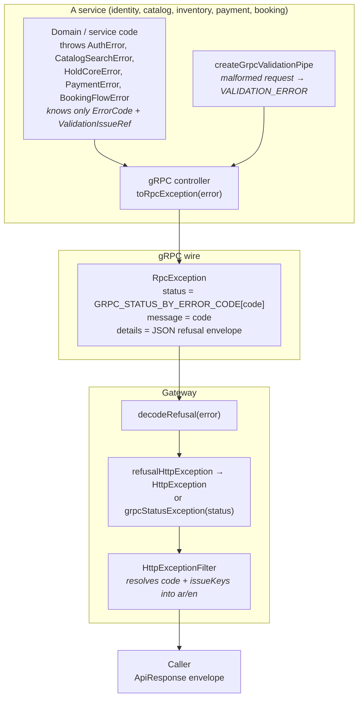
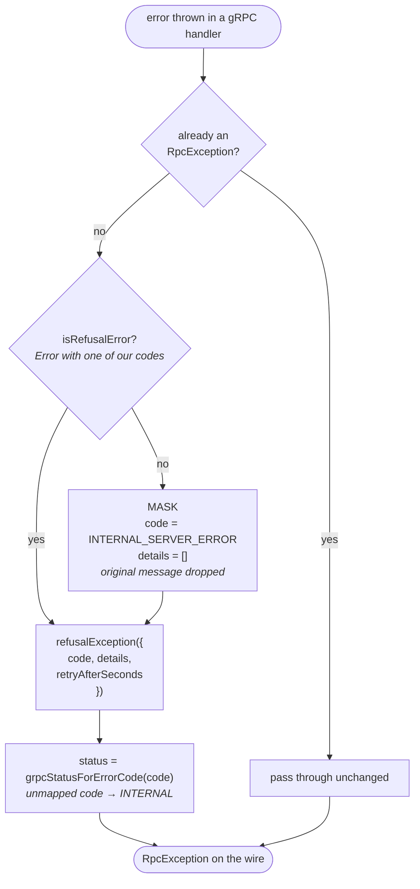
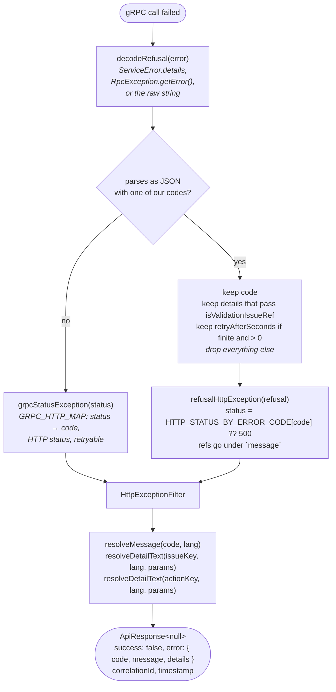
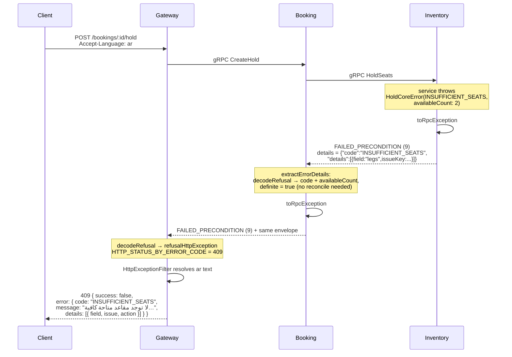
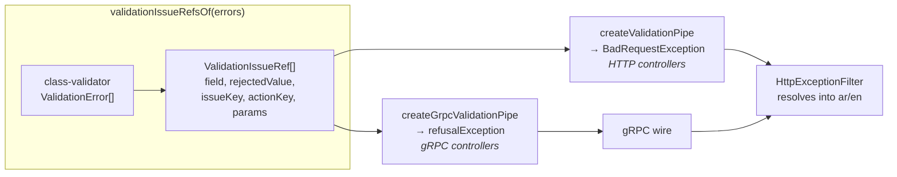
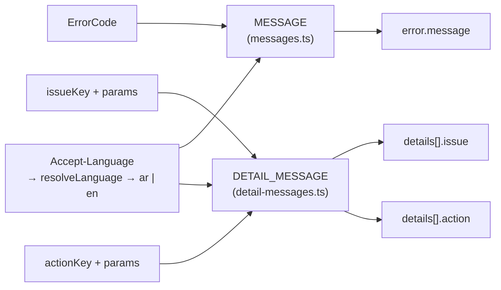
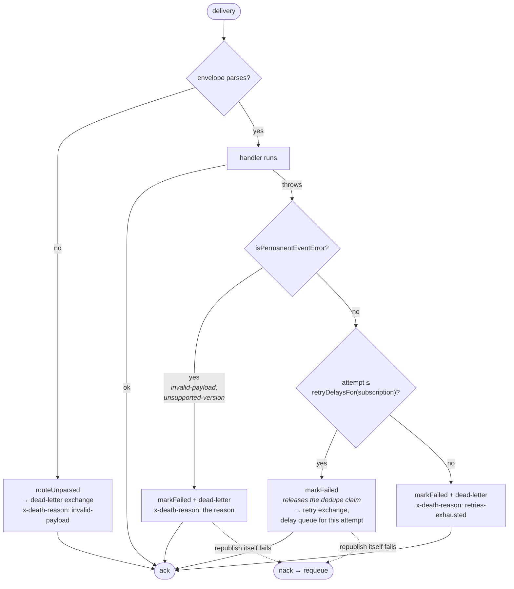

# Error Handling Across the Services

How a failure travels from the line of code that decided it to the sentence a
traveller reads, and what each layer is allowed to do to it on the way.

## Contents

- [The one rule](#the-one-rule)
- [Where the text comes from](#where-the-text-comes-from)
  - [Every service has the filter, but only one uses it](#every-service-has-the-filter-but-only-one-uses-it)
- [The layers](#the-layers)
- [What crosses the transport](#what-crosses-the-transport)
- [Outbound: a thrown error becomes a status](#outbound-a-thrown-error-becomes-a-status)
- [Inbound: a failed call becomes HTTP](#inbound-a-failed-call-becomes-http)
- [End to end: not enough seats](#end-to-end-not-enough-seats)
- [Validation errors](#validation-errors)
- [Localization](#localization)
  - [Where it happens](#where-it-happens)
  - [What follows from it being only here](#what-follows-from-it-being-only-here)
- [What the filter does with statuses that arrive without a code](#what-the-filter-does-with-statuses-that-arrive-without-a-code)
- [Asynchronous failures: events](#asynchronous-failures-events)
- [Where everything lives](#where-everything-lives)
- [Adding a failure](#adding-a-failure)

## The one rule

A service decides **a code**, never a status and never a sentence.

- The **code** is an `ErrorCode` from `libs/contracts/src/error-codes.enum.ts`.
  It is the whole message.
- The **status** — gRPC or HTTP — is derived from the code by one table, at the
  transport boundary.
- The **text** is resolved at the edge only, from the caller's
  `Accept-Language`, into Arabic or English (BR-57). A service that wrote a
  sentence would answer every caller in one language.

Anything we did not decide — a Postgres error, a driver timeout, a bug — is
masked as `INTERNAL_SERVER_ERROR` with no detail. It is never rethrown as it
arrived: a driver message can carry SQL, national IDs and tokens, and gRPC
would put it on the wire verbatim.

## Where the text comes from

Translation happens in exactly one place: `HttpExceptionFilter` in
`@app/common`. Nothing upstream of it holds text. A refusal travels as a code
plus language-free `issueKey` / `actionKey` refs, and the filter turns them
into sentences in four lookups:

```text
Accept-Language: en          →  resolveLanguage            →  'en'
code: INSUFFICIENT_SEATS     →  MESSAGE[code][lang]        →  error.message
issueKey: ISSUE_NOT_ENOUGH…  →  DETAIL_MESSAGE[key][lang]  →  details[].issue
actionKey: ACTION_FEWER…     →  DETAIL_MESSAGE[key][lang]  →  details[].action
```

Every catalogue entry holds both `ar` and `en`, and `{{name}}` placeholders in
it are filled from the ref's `params` — so the same refusal reads correctly in
either language, and a missing header defaults to Arabic. The line-level
detail, and what follows from the resolution living only here, is under
[Localization](#localization).

### Every service has the filter, but only one uses it

[`setupApp`](../libs/common/src/setup.ts) registers `HttpExceptionFilter`, and
every service calls `setupApp`. So all seven services carry it.

Only the gateway answers callers over HTTP, so only the gateway's filter runs
on a real request. Between services we use gRPC, and the filter is not on that
path. The other services only serve health probes.

This is also why text cannot be made earlier: `Accept-Language` is not passed
between services, so only the gateway knows the language. A service that
translated mid-call would always answer in Arabic.

If an internal call ever becomes HTTP, we will move the filter to the gateway only
instead of `setupApp`, and let the inner service answer with the plain refusal
— `{ code, details, retryAfterSeconds }`, no text — like it does over gRPC.

## The layers



Each service keeps its own error class with its own extra fields. They are not
a shared base class; they answer to one *structural* shape, checked by
`isRefusalError`:

```ts
type RefusalError = Error & {
  readonly code: ErrorCode;
  readonly details?: ValidationIssueRef[];
  readonly retryAfterSeconds?: number;
};
```

The code must be one of ours. An error that merely happens to carry a `code` is
not mistaken for a decision — Postgres says `'23505'` and Node says `'ENOENT'`,
and neither is a refusal to report.

## What crosses the transport

One envelope shape, for every service
([service-refusal.ts](../libs/common/src/errors/service-refusal.ts)):

```json
{
  "code": "INSUFFICIENT_SEATS",
  "details": [
    {
      "field": "legs",
      "rejectedValue": { "availableCount": 2 },
      "issueKey": "ISSUE_NOT_ENOUGH_SEATS_ON_TRAIN",
      "actionKey": "ACTION_FEWER_PASSENGERS_OR_ANOTHER_CLASS"
    }
  ],
  "retryAfterSeconds": 3
}
```

JSON-encoded into the `details` field of an `RpcException`. There is no text in
it, by design. Facts a caller can act on — a seat count, a passenger ref —
travel inside `details[].rejectedValue`, not as envelope fields of their own,
so every service answers in one shape. A ref travels, never a national ID
inventory does not hold.

## Outbound: a thrown error becomes a status

[`toRpcException`](../libs/common/src/errors/to-rpc-exception.ts) is the one
place this happens, for every service.



`retryAfterSeconds` comes either from the error itself, or from a per-service
hook. Catalog is the only user: it advertises how long to wait for a dependency
that is down, which is configuration rather than a property of the error
([catalog/.../to-rpc-exception.ts](../apps/catalog/src/modules/trips/to-rpc-exception.ts)).

Booking's wrapper adds nothing — it is the shared helper. A `BookingFlowError`
carries a code and is answered; a `BookingFlowFault` carries none and is
masked, which is what a fault should do.

## Inbound: a failed call becomes HTTP



Nothing in `decodeRefusal` is trusted. An unknown code, a malformed detail, or
a service-authored sentence is dropped rather than passed to a caller. A
refusal that does not decode falls back to the transport status alone, which
never leaks upstream `details`.

`GRPC_HTTP_MAP` and `GRPC_STATUS_BY_ERROR_CODE` are **not inverses** — several
codes share one status, and the reverse map is deliberately lossy:
`PERMISSION_DENIED` maps back to 404, so "not yours" and "does not exist" are
indistinguishable to a caller.

## End to end: not enough seats



Note what booking does **not** do: it does not re-decide the code or translate
anything. It reads out only what it needs — whether the outcome is *definite*.
An indefinite outcome (`INTERNAL_SERVER_ERROR` or `SERVICE_UNAVAILABLE`, both
collapsed to `DEPENDENCY_UNAVAILABLE`) means the call may or may not have held
seats, so the draft must reconcile rather than refuse
([booking-draft.errors.ts](../apps/booking/src/modules/draft/booking-draft.errors.ts)).

## Validation errors

A malformed request is a refusal like any other: `VALIDATION_ERROR`, with one
detail per offending field. BR-57 requires the field *and* the rejected value
to be named — "the request is invalid" is not enough.



Two things worth knowing:

- Constraint names map to catalogue keys through `CONSTRAINT_ISSUE_KEYS`
  (`isEmail` → `ISSUE_MUST_BE_EMAIL`). A validator can override with
  `issueKey`, `actionKey` and `params` in its `context`.
- The gRPC pipe strips `rejectedValue` for any field matching
  `/token|password|secret/i`. A trip-scoped HMAC token is not something a
  traveller typed and could correct, so naming the field is the whole of what a
  caller can act on. A submitted National ID is deliberately *not* stripped —
  identity echoes it so the traveller can see the digit they got wrong.

Global pipes do not reach a `@GrpcMethod`: `connectMicroservice` is called
without `inheritAppConfig`, so each gRPC controller applies
`createGrpcValidationPipe()` itself.

## Localization



Both catalogues carry `ar` and `en` for every key.

### Where it happens

In exactly one place: `HttpExceptionFilter`, at the HTTP edge. Nothing upstream
of it ever holds text. Three calls do the whole job, all in
[http-exception.filter.ts](../libs/common/src/envelope/http-exception.filter.ts):

| Line | Call | Produces |
| --- | --- | --- |
| [:45](../libs/common/src/envelope/http-exception.filter.ts#L45) | `resolveLanguage(req.headers['accept-language'])` | `'ar'` or `'en'` |
| [:137](../libs/common/src/envelope/http-exception.filter.ts#L137) | `resolveMessage(code, lang)` | `error.message` — from the `ErrorCode` |
| [:202](../libs/common/src/envelope/http-exception.filter.ts#L202-L208) | `resolveDetailText(issueKey / actionKey, lang, params)` | `details[].issue` and `details[].action` |

The resolvers are the catalogue lookups themselves:
[`resolveMessage`](../libs/common/src/envelope/messages.ts#L348) over `MESSAGE`,
and [`resolveDetailText`](../libs/common/src/envelope/detail-messages.ts#L821)
over `DETAIL_MESSAGE` by way of `resolveMessageWithParams`, which fills
`{{name}}` placeholders from the ref's `params`.

### What follows from it being only here

- **Arabic is the default.**
  [`resolveLanguage`](../libs/common/src/envelope/messages.ts#L326) returns
  `'ar'` for a missing header, and for any header whose tags match neither
  `en*` nor `ar*`. It is a first-match scan over the comma-separated tags — `q`
  weights are parsed off and ignored.
- **Success messages translate too**, at
  [response.interceptor.ts:62](../libs/common/src/envelope/response.interceptor.ts#L62),
  the same way: `resolveMessage(ErrorCode.SUCCESS, lang)`.
- **Fallback chain:** requested language → `ar` → a hardcoded generic sentence.
  A key with only `ar` filled still answers an English caller in Arabic rather
  than with a bare code.
- **An unfilled template never surfaces.** A leftover `{{…}}` after param
  substitution — version skew between a producer and the catalogue — is
  replaced with `ISSUE_VALIDATION_FAILED`, and an unknown `actionKey` falls
  back to `ACTION_DEFAULT`. `resolveDetailText` separately substitutes
  `ISSUE_VALIDATION_FAILED` for a key absent from `DETAIL_MESSAGE`.
- Because every service wires `HttpExceptionFilter` through `setupApp`, a
  non-gateway service's own HTTP surface — its health endpoints — localizes as
  well. The gRPC path never does: a refusal crossing the wire carries
  `message = code`, and the code is the message.

## What the filter does with statuses that arrive without a code

`HttpExceptionFilter` catches *everything*, including exceptions Nest itself
raised, which carry no `ErrorCode`. It back-fills one from the HTTP status —
404 → `ROUTE_NOT_FOUND`, 401 → `UNAUTHORIZED`, 503 →
`SERVICE_UNAVAILABLE`, anything ≥ 500 → `INTERNAL_SERVER_ERROR`, any other 4xx
→ `BAD_REQUEST` — and only when no trusted code was present. A non-`HttpException`
is a 500 with no message and no stack. The full error always goes to the
correlated log, never to the response.

Field-level details are only published for statuses where they are a business
refusal: 400 (validation), 404, 409, and 503 when the code is
`DEPENDENCY_UNAVAILABLE`. An ordinary server error stays log-only.

## Asynchronous failures: events

A failed event handler has no caller to refuse, so the question is retry,
dead-letter, or requeue — never a status code.



Two details that matter:

- The dedupe claim is released with `markFailed` *before* republishing, or the
  retry would be dropped as a duplicate by the processed-event store.
- A failure to route the failure is the only `nack`. The delivery is requeued
  rather than acknowledged, because acknowledging it would lose the event.
- A permanent error's `reason` controls replay later: an invalid payload can
  never replay; an unsupported version can, once the consumer is updated.

The outbox relay is the other half, and it only ever retries — a row stays in
the outbox until it publishes, with `relayBackoffMs` growing 250 ms → 5 s and
capping there, so a backlog drains quickly after a broker recovers.

## Where everything lives

| Concern | File |
| --- | --- |
| The code enum | [error-codes.enum.ts](../libs/contracts/src/error-codes.enum.ts) |
| code → gRPC status | [error-code-grpc.ts](../libs/contracts/src/error-code-grpc.ts) |
| code → HTTP status | [error-code-http.ts](../libs/contracts/src/error-code-http.ts) |
| gRPC status → code + HTTP (no envelope) | [grpc-status.ts](../libs/contracts/src/grpc-status.ts) |
| Language-free detail ref | [validation-issue-ref.ts](../libs/contracts/src/validation-issue-ref.ts) |
| Refusal shape + `isRefusalError` | [service-refusal.ts](../libs/common/src/errors/service-refusal.ts) |
| Throw → gRPC | [to-rpc-exception.ts](../libs/common/src/errors/to-rpc-exception.ts) |
| Wire → refusal | [decode-refusal.ts](../libs/common/src/errors/decode-refusal.ts) |
| Refusal → HTTP | [to-http-exception.ts](../libs/common/src/errors/to-http-exception.ts) |
| gRPC status alone → HTTP | [grpc-status.exception.ts](../libs/common/src/grpc/grpc-status.exception.ts) |
| gRPC request validation | [grpc-validation.pipe.ts](../libs/common/src/errors/grpc-validation.pipe.ts) |
| HTTP request validation | [validation-exception.factory.ts](../libs/common/src/envelope/validation-exception.factory.ts) |
| The edge | [http-exception.filter.ts](../libs/common/src/envelope/http-exception.filter.ts) |
| Code text (ar/en) | [messages.ts](../libs/common/src/envelope/messages.ts) |
| Issue and action text (ar/en) | [detail-messages.ts](../libs/common/src/envelope/detail-messages.ts) |
| Global wiring | [setup.ts](../libs/common/src/setup.ts) |
| Event retry / dead-letter | [event-failure-router.ts](../libs/messaging/src/consumer/event-failure-router.ts), [event-errors.ts](../libs/messaging/src/event-errors.ts) |

Per-service error classes:
[AuthError](../apps/identity/src/modules/auth/auth-error.ts) ·
[CatalogSearchError](../apps/catalog/src/modules/trips/catalog-search-error.ts) ·
[HoldCoreError](../apps/inventory/src/modules/seat-hold/hold-core.errors.ts) ·
[PaymentError](../apps/payment/src/modules/charges/payment-error.ts) ·
[BookingFlowError / BookingFlowFault](../apps/booking/src/modules/flow/booking-flow-error.ts) ·
[BookingDraftError](../apps/booking/src/modules/draft/booking-draft.errors.ts)

## Adding a failure

1. Add the code to `ErrorCode`.
2. Add a row to **both** status tables. An unmapped code is `INTERNAL` / 500 —
   which reads as our bug, not the caller's. Pick `FAILED_PRECONDITION` when a
   retry cannot pass, `ABORTED` when it can.
3. Add `ar` and `en` to `MESSAGE`.
4. If the caller can act on a specific field, add `ISSUE_*` and `ACTION_*` keys
   to `DETAIL_MESSAGE` in both languages, and return a `ValidationIssueRef`
   from the error class's `details`.
5. Throw the service's own error class. Do not touch a status, a transport, or
   a sentence anywhere in the service.
