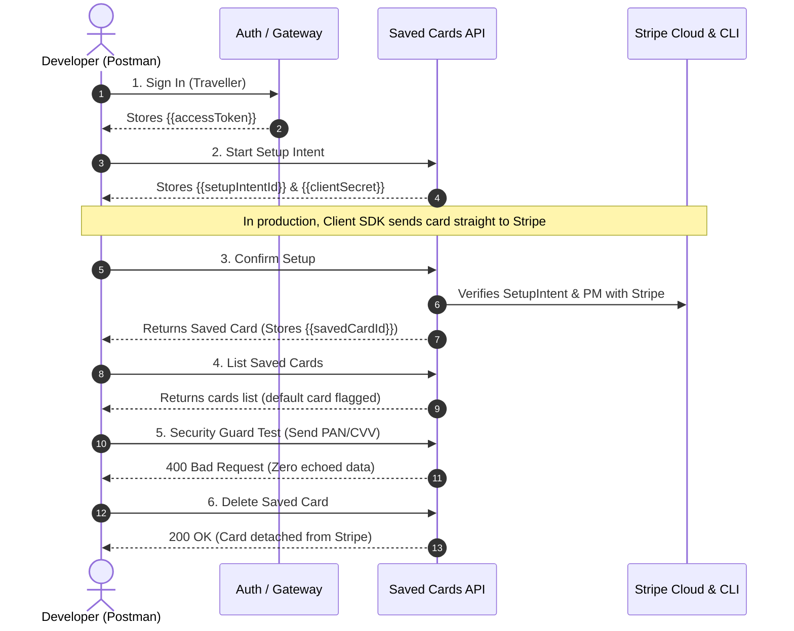

# Stripe Integration & Saved Cards: Local Testing Guide

A step-by-step developer guide for setting up, pairing Stripe CLI, running database migrations, and testing the Saved Cards feature locally using Postman.

---

## 1. Overview & Architecture

The **Saved Cards** feature allows train travellers to save debit/credit cards securely for one-tap payments on future train bookings without having to re-type 16 digits.

### Key Rules & Invariants
* **Zero Card Data in ENR (BR-32 & PCI DSS):** ENR Gateway, Payment service, databases, and logs **never** receive, see, store, or log Primary Account Numbers (PAN), CVVs, or full expiry details. The Stripe Client SDK handles card data directly.
* **Setup, Not Charge:** Saving a card uses Stripe's `SetupIntent` API (`usage: off_session`). No money is charged.
* **1 Stripe Customer Per Account:** Payment maps each traveller account to exactly one Stripe customer (`payment_customer` table) using account-derived idempotency keys.
* **Two-Way Synchronization:** Payment verifies setups through either:
  1. Client reporting back (`POST /api/v1/saved-cards/confirm`)
  2. Stripe webhook (`setup_intent.succeeded`)
* **Default Card Rule:** Dynamically selects the card used last for payment (`last_used_at`), falling back to the newest valid card. Expired cards cannot be default.

---

## 2. Environment Variables Setup

Ensure your local `.env` file contains the following Stripe configuration:

```env
# Stripe Test Configuration
STRIPE_SECRET_KEY=sk_test_placeholder_key_from_stripe_dashboard
STRIPE_PUBLISHABLE_KEY=pk_test_placeholder_key_from_stripe_dashboard
PUBLISHABLE_KEY=pk_test_placeholder_key_from_stripe_dashboard
STRIPE_WEBHOOK_SECRET=whsec_placeholder
```

> **Note:** You will update `STRIPE_WEBHOOK_SECRET` with your local CLI secret in Step 4.

---

## 3. Stripe CLI Installation & Pairing

The Stripe CLI lets you forward test webhook events directly to your local service without creating any public tunnels or configuring endpoints in the Stripe Dashboard.

### Step 3.1: Install Stripe CLI

#### Windows:
Open PowerShell and run:
```powershell
winget install Stripe.StripeCLI
# Or via Chocolatey:
choco install stripe-cli
```
*(If PowerShell says `stripe : The term 'stripe' is not recognized`, close and reopen your terminal window so the Windows `PATH` refreshes).*

#### macOS:
```bash
brew install stripe/stripe-cli/stripe
```

#### Linux:
```bash
curl -s https://packages.stripe.dev/api/security/keypair/stripe-cli-gpg/public | gpg --dearmor | sudo tee /usr/share/keyrings/stripe.gpg
echo "deb [signed-by=/usr/share/keyrings/stripe.gpg] https://packages.stripe.dev/stripe-cli-debian-local stable main" | sudo tee -a /etc/apt/sources.list.d/stripe.list
sudo apt update && sudo apt install stripe
```

---

### Step 3.2: Authenticate with Stripe (Team Authorization Flow)

The team's shared Stripe test account is registered under the project lead's Google account. When pairing your CLI:

1. In your terminal, run:
   ```powershell
   stripe login
   ```
2. The terminal will output an authorization URL and code:
   ```json
   {
     "browser_url": "https://access.stripe.com/stripecli/oauth2/device?user_code=XXXX-XXXX",
     "verification_code": "XXXX-XXXX",
     "next_step": "stripe login --complete-device"
   }
   ```
3. **Send the `browser_url` (or the verification code) to the account owner (Youssef)** on Slack/Teams/WhatsApp.
4. The account owner will open the link in their browser and click **Allow access** / **Authorize**.
5. Once the account owner approves it, return to your terminal and complete the pairing:
   ```powershell
   stripe login --complete-device
   ```
6. Your CLI is now authenticated with the shared Stripe test account!

---

## 4. Run Webhook Forwarding

Start forwarding Stripe test events to the local payment service:

```powershell
stripe listen --forward-to localhost:3005/webhooks/stripe --events setup_intent.succeeded
```

> **Important:** The `--events` flag is required. You can also forward all events using `--all-snapshot`.

The terminal will print:
```text
> Ready! You are using Stripe CLI in test mode.
> Ready! Your webhook signing secret is whsec_xxxxxxxxxxxxxxxxxxxxxx (^C to quit)
```

1. Copy the printed `whsec_...` secret.
2. Open your `.env` file and set:
   ```env
   STRIPE_WEBHOOK_SECRET=whsec_xxxxxxxxxxxxxxxxxxxxxx
   ```
3. **Keep this terminal window open** while testing.

---

## 5. Run Database Migrations

Apply the new database migration (`CreateStripeCustomersAndSavedCards1796000000001`):

```powershell
# If running services locally:
npm run migration:run -d apps/payment/src/database/data-source.ts

# Or if running inside Docker Compose:
docker compose exec payment npm run migration:run
```

---

## 6. Start the Services

Start the platform services:

```powershell
# Via Docker Compose:
docker compose up -d

# Or run payment and gateway directly in host mode:
npx nest start payment
npx nest start gateway
```

---

## 7. Testing the Flow in Postman

We have updated the Postman platform collection with a dedicated **"Saved Cards (Gateway & Stripe)"** folder.

### Setup Postman:
1. Import `postman/train-app-platform.postman_collection.json`.
2. Import `postman/train-app-local.postman_environment.json`.
3. Select the environment: **Train App - Local Environment**.

### Execution Steps:



1. **Authenticate First:**
   * Go to folder **`Authentication (Gateway)`** $\rightarrow$ execute **`Sign In (Traveller)`**.
   * This automatically saves your `{{accessToken}}` in the environment.

2. **Step 1: Start Setup Intent**
   * Open **`Saved Cards (Gateway & Stripe)`** $\rightarrow$ execute **`Start Setup Intent (Add Card Step 1)`**.
   * **Route:** `POST {{baseUrl}}/api/v1/saved-cards/setup`
   * **Result:** Creates (or retrieves) the Stripe Customer for the traveller, starts a `SetupIntent`, and automatically saves `{{setupIntentId}}`, `{{stripeClientSecret}}`, and `{{stripePublishableKey}}` into your environment.

3. **Step 1.5 (Simulate Frontend): Confirm Card with Stripe**
   * **Target:** `POST https://api.stripe.com/v1/setup_intents/{{setupIntentId}}/confirm` *(Stripe Cloud API directly, NOT our backend)*.
   * **Why this step exists:** Under **PCI DSS & BR-32**, ENR never receives or processes card numbers. In a production app, the frontend uses Stripe Elements or the Stripe Mobile SDK to send the card directly from the customer's phone to Stripe.
   * **How card details get added in Postman testing:**
     * The simulation request passes `payment_method: pm_card_visa` to `api.stripe.com`.
     * `pm_card_visa` is Stripe's official test token that automatically attaches a test Visa card (`4242...4242`, future expiry, CVC `123`) to the `SetupIntent` on Stripe's servers and sets its status to `succeeded`.
     * *(Other test cards you can try: `pm_card_mastercard`, `pm_card_amex`, `pm_card_chargeCustomerFail`)*.
     * **Automation:** Postman Step 2 also includes a Pre-request script that automatically executes this confirmation with `pm_card_visa` behind the scenes, so running Step 2 directly works out-of-the-box!

4. **Step 2: Confirm Setup (Record Card in ENR)**
   * Execute **`Confirm Setup (Add Card Step 2)`**.
   * **Route:** `POST {{baseUrl}}/api/v1/saved-cards/confirm`
   * **Payload:** `{ "setupIntentId": "{{setupIntentId}}" }`
   * **Result:** Our Payment Service calls Stripe over HTTPS to retrieve the succeeded `SetupIntent` and its newly attached PaymentMethod. It safely extracts the sanitized display fields (`brand`, `last4`, `expMonth`, `expYear`, `fingerprint`) and inserts them into PostgreSQL (`saved_card` table). Saves `{{savedCardId}}`.

5. **Step 3: List Saved Cards**
   * Execute **`List Saved Cards`**.
   * **Route:** `GET {{baseUrl}}/api/v1/saved-cards`
   * **Result:** Returns the unified list of saved cards directly from the database (no Stripe latency). Marks exactly one usable card as `isDefault: true`.

6. **Step 4: Security Guard Verification (BR-32 / PCI DSS)**
   * Execute **`Security Guard - Attempt Sending PAN/CVV (Refused)`**.
   * **Payload:** `{ "cardNumber": "4242424242424242", "cvv": "123" }`
   * **Result:** Gateway's `CardDataSanitizationGuard` intercepts the request and returns `400 Bad Request` with `ErrorCode.INVALID_PAYLOAD`. The test script asserts that the card number and CVV are **never echoed back** in the response or logs.

7. **Step 5: Delete Saved Card**
   * Execute **`Delete Saved Card`**.
   * **Route:** `DELETE {{baseUrl}}/api/v1/saved-cards/{{savedCardId}}`
   * **Result:** Detaches the payment method from the traveller's Stripe customer and updates its status to `detached`. Past booking payments keep their recorded brand and last 4.

---

## 8. Stripe Test Card Numbers Reference

When confirming setups via Stripe client SDKs or automated tests:

| Card Type | Card Number | Expiry | CVC | Expected Result |
| :--- | :--- | :---: | :---: | :--- |
| **Visa (Standard)** | `4242 4242 4242 4242` | Any future date | `123` | Setup succeeds immediately |
| **Mastercard** | `5555 5555 5555 4444` | Any future date | `123` | Setup succeeds immediately |
| **3-D Secure** | `4000 0025 0000 3155` | Any future date | `123` | Requires 3DS authentication challenge |
| **Card Declined** | `4000 0000 0000 0002` | Any future date | `123` | Setup fails (`setup_intent.failed`) |

---

## 9. Troubleshooting & FAQ

#### Q: PowerShell says `stripe: The term 'stripe' is not recognized`
**Fix:** After installing via winget/choco, close and reopen your terminal, or refresh PATH in PowerShell:
```powershell
$env:Path = [System.Environment]::GetEnvironmentVariable("Path","User") + ";" + [System.Environment]::GetEnvironmentVariable("Path","Machine")
```

#### Q: `stripe listen` says `must specify events to forward`
**Fix:** Append `--events setup_intent.succeeded` or `--all-snapshot`:
```powershell
stripe listen --forward-to localhost:3005/webhooks/stripe --events setup_intent.succeeded
```

#### Q: Payment service refuses to boot (`Configuration error: Missing required environment variable`)
**Fix:** Check that `.env` defines `STRIPE_SECRET_KEY` and `STRIPE_WEBHOOK_SECRET`. The payment service validates these variables at boot to prevent runtime payment failures.

#### Q: Do I need to create a webhook endpoint in the Stripe Dashboard?
**A:** **No, not for local development!** The Stripe CLI (`stripe listen`) automatically tunnels events to `localhost:3005`. The Stripe Dashboard webhook endpoint is only needed for deployed staging and production environments (see Section 10 below).

---

## 10. Creating a Webhook in the Stripe Dashboard (Staging & Production)

When deploying to staging or production (or if you prefer a permanent webhook endpoint without running the Stripe CLI):

1. **Go to Stripe Webhooks in the Dashboard:**
   * Navigate to: [https://dashboard.stripe.com/test/webhooks](https://dashboard.stripe.com/test/webhooks) (make sure **Test Mode** toggle in the top right is active).
2. **Add an Endpoint:**
   * Click the **+ Add destination** or **+ Add endpoint** button in the top right.
3. **Configure Endpoint Details:**
   * **Endpoint URL:** Enter the public URL where your payment service receives webhooks:
     `https://<your-api-domain>/webhooks/stripe`
     *(For local testing with Ngrok / Cloudflare tunnel, use `https://<your-tunnel-subdomain>/webhooks/stripe`)*.
   * **Description:** e.g. `Train App Payment Service - Setup Intents`.
   * **Listen to:** Select **Events on your account**.
4. **Select Webhook Events:**
   * Click **+ Select events**.
   * Under the **Setup intent** category, select:
     * `setup_intent.succeeded`
   * *(Optional if you handle cards or charges later: `payment_intent.succeeded`, `payment_method.detached`)*.
   * Click **Add events**.
5. **Create & Reveal Secret:**
   * Click **Add endpoint** at the bottom of the modal.
   * On the webhook details page, locate the **Signing secret** card on the right-hand side.
   * Click **Reveal**.
   * Copy the secret string (starts with `whsec_...`).
6. **Update `.env` & Restart:**
   * Put the revealed secret into your `.env` file:
     ```env
     STRIPE_WEBHOOK_SECRET=whsec_your_copied_secret_here
     ```
   * Restart the payment container (`docker compose restart payment`).

