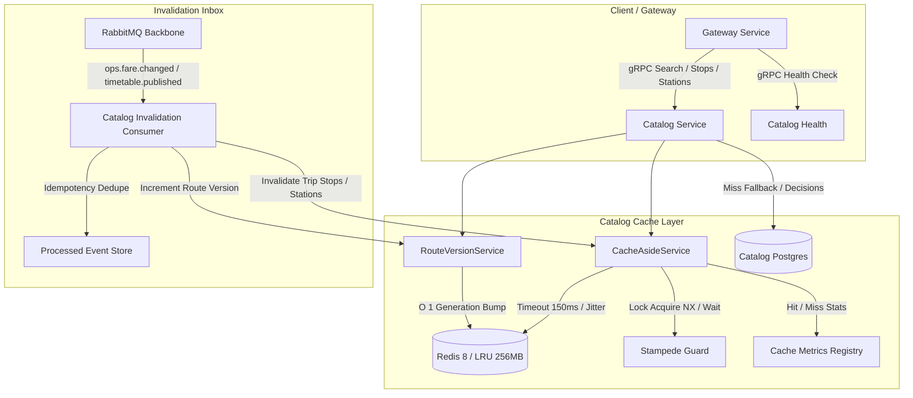

# Redis-Postgres Cache Layer Implementation Plan

> **For agentic workers:** REQUIRED SUB-SKILL: Use superpowers:subagent-driven-development (recommended) or superpowers:executing-plans to implement this plan task-by-task. Steps use checkbox (`- [ ]`) syntax for tracking.

**Goal:** Provide an industrial-grade cache-aside layer inside `catalog` where Redis serves high-volume reads (stations, search results, trip stops, segment availability) without ever being trusted with business decisions, featuring $O(1)$ bulk route invalidation without `KEYS`, multi-instance stampede protection, single-outage logging, degraded health resilience, hit/miss metrics, and automated demo verification.

**Architecture:** The cache layer sits entirely inside the `catalog` service behind CAT-1 (stations), CAT-3 (trip search), and CAT-4 (trip stops). Search results use generational route-versioning (`catalog:route-version:v1:<origin>:<destination>`) so that republishing a timetable or updating fares invalidates up to 10,000 cached search results in $O(1)$ time with zero Redis `KEYS`/`SCAN` calls while leaving unrelated routes warm. Distributed stampede protection via short-lived Redis leases ensures 200 concurrent cold searches trigger exactly one Postgres rebuild across catalog instances, with in-process singleflight promise coalescing and graceful fallback to Postgres when Redis is slow or unavailable. Seat availability lives in decoupled per-segment keys (`catalog:availability:v1:...`) merged at read time, ensuring inventory updates never invalidate route search lists and timetable changes never touch counts they did not affect.

**Tech Stack:** NestJS, TypeScript, ioredis, TypeORM, PostgreSQL 17, Redis 8 (Alpine), RabbitMQ (amqplib), Vitest.

**Spec:** User story: "The cache layer — fast answers from Redis, correct answers from Postgres" (§2.3, §6.3, BR-29, CAT-1, CAT-3, CAT-4, OPS-1, SEAT-4).

---

## Global Constraints

- **Cache Displays, Database Decides (§2.3 rule 1, BR-29):** No business decision reads from Redis (no trip generator, no fare validation, no booking hold, no payment quote). Redis is display-only.
- **Key Ownership and Policy (§2.3 rule 2):** Every key family has a documented owner, TTL band with jitter, and explicit invalidation trigger.
- **Named & Versioned Keys (§2.3 rule 5):** Keys adhere to `catalog:<family>:v<version>:...`. Schema migrations bump version tags; old versions are abandoned.
- **Jittered TTLs (§2.3 rule 4):** Every write randomizes its TTL within a documented percentage band (e.g. $\pm 10\%$) so synchronized writes do not expire concurrently.
- **No Stampede across Instances (§2.3 rule 3):** Concurrent cold cache requests coalesce into a single Postgres rebuild across multiple service replicas.
- **No KEYS at Scale (§6.3):** Invalidation of massive search combinations (10,000+ keys) occurs in $O(1)$ time via route version epochs without `KEYS` or blocking `SCAN`.
- **Invalidation Beats Slow Rebuild:** Rebuild reads verify or pin route version before database fetch, discarding stale writes completed after an invalidation.
- **Decoupled Availability Keys (§2.3, SEAT-4):** Available seats per trip, class, and segment are stored under separate keys and merged at query time; inventory updates never invalidate static trip lists.
- **Empty Result Caching:** Searches returning zero trips are cached with shorter jittered TTLs and invalidated upon timetable publishing.
- **Language Independence (§2.3 rule 6):** Cached static payloads store bilingual localized records (`{ en, ar }`); translation happens at the presentation boundary, eliminating per-language cache duplication.
- **Degraded Resilient Operation (§2.3 rule 7):** Every Redis command enforces a strict timeout ($\le 150\text{ms}$). Outages log once rather than per request, report `degraded` readiness to Gateway, and fall back to Postgres without throwing errors.
- **Measured Hit Rate (§2.3 rule 8):** Key families track atomic hit/miss counters exposed via metrics for demo evaluation.
- **Bounded Memory:** Redis is capped at 256MB with `allkeys-lru` eviction policy in Docker Compose.

---

## Review Focus

1. **Slow Rebuild Interleaving Race Condition:** A search rebuild queries Postgres at $T_1$ with old fare; at $T_2$ OPS-1 changes the fare and increments the route version; at $T_3$ the rebuild writes back. *Expected behavior:* The write occurs under the old route version (or is discarded via version check), leaving the new route version pristine and the next search returning the new fare immediately.
2. **Redis Slow Hang vs Hard Outage:** Redis latency spikes to 2 seconds or socket drops. *Expected behavior:* Operation timeout kicks in within 150ms, the request resolves from Postgres, outage is logged once, and subsequent calls immediately proceed without unhandled promise rejections.
3. **Empty Answer Poisoning:** A user searches a date/route with no scheduled trains, then an operator publishes a timetable for that date/route. *Expected behavior:* The empty answer was cached under the route version; the timetable publish event increments the route version, making the empty answer instantly unreachable.
4. **200-Request Stampede Split Across 2 Catalog Instances:** 200 concurrent requests for an unpopulated search route hit 2 separate catalog instances. *Expected behavior:* Exactly 1 database query executes across the entire cluster; 199 requests await the result and return the warm cached data.
5. **Duplicate / Out-of-Order Invalidation Event:** RabbitMQ delivers the same fare-changed event twice, or an older event arrives after a newer one. *Expected behavior:* Event consumer deduplicates via processed events store, and monotonically checks timestamp/epoch to prevent version regression.

---

## Architecture Overview

---

## Key Catalog & Policy Table (PLAT-1 Spec)

| Key Family | Pattern | Owner | Base TTL | Jitter Band | Invalidation Trigger | Stored Value |
|---|---|---|---|---|---|---|
| **Route Version** | `catalog:route-version:v1:<from>:<to>` | Catalog (Trips) | None (Persistent) | None | Timetable published, fare changed for route | Integer epoch counter |
| **Search Results** | `catalog:search:v2:<from>:<to>:<date>:<class>:<train>:rv<ver>` | Catalog (Trips) | 300s (future) 60s (today / empty) | $\pm 10\%$ (270–330s / 54–66s) | Route version bump (instant $O(1)$) | `CachedStaticTrip[]` (bilingual, no inventory) |
| **Availability** | `catalog:availability:v1:<tripId>:<from>:<to>:<class>` | Catalog (Trips / Inventory) | 60s | $\pm 10\%$ (54–66s) | Seat sold/released (SEAT-4) | Integer seat count |
| **Trip Stops** | `catalog:trip-stops:v1:<tripId>:<from>:<to>` | Catalog (Trips) | 6h (21,600s) | $\pm 10\%$ (19,440–23,760s) | Timetable changed for trip | `CachedTripStop[]` (bilingual ordered stops) |
| **Station List** | `catalog:stations:v1` | Catalog (Stations) | 24h (86,400s) | $\pm 10\%$ (77,760–95,040s) | Station added/updated/deactivated | `StationCatalog` (hierarchical governorates/cities/stations) |
| **Stampede Lock** | `lock:catalog:<family>:<keyHash>` | Catalog (CacheAside) | 5s | None | Explicit unlock on rebuild completion | Worker process identifier |

---

## Tasks Breakdown

### Task 1: Bounded Redis Configuration & Core Resilience Infrastructure
**Files:**
- Modify: `docker-compose.yml:55-66`
- Create: `libs/common/src/cache/cache-metrics.ts`
- Modify: `libs/common/src/cache/redis-client.service.ts`
- Test: `test/integration/cache-resilience.int-spec.ts`

**Interfaces:**
- Consumes: `RedisClientService`
- Produces: `CacheMetrics` registry (`recordHit`, `recordMiss`, `getSnapshot`), `RedisClientService.onAvailabilityChange(callback)`.

- [ ] **Step 1: Write integration tests for operation timeout, single-outage logging, and metrics**
  Assert that Redis calls hanging over 150ms fail fast with null/fallback, connection transitions log only once at transition boundary, and metrics accurately track hits and misses per key family.
- [ ] **Step 2: Run test to verify it fails**
  Run `cmd /c npx vitest run test/integration/cache-resilience.int-spec.ts` (Expected: FAIL).
- [ ] **Step 3: Implement Redis configuration and resilience mechanisms**
  - Update `docker-compose.yml` to specify `command: ["redis-server", "--maxmemory", "256mb", "--maxmemory-policy", "allkeys-lru"]`.
  - Implement `CacheMetrics` in `libs/common/src/cache/cache-metrics.ts` with atomic counters for `search`, `trip-stops`, `stations`, and `availability`.
  - Add stateful edge-triggered logging to `RedisClientService` so that dropping Redis logs a single WARN and reconnecting logs a single INFO.
- [ ] **Step 4: Run test to verify it passes**
  Run `cmd /c npx vitest run test/integration/cache-resilience.int-spec.ts` (Expected: PASS).
- [ ] **Step 5: Commit changes**
  `git commit -m "feat(cache): bounded redis compose, metrics tracking, and single-outage logging"`

---

### Task 2: Distributed Stampede Guard & Operation Timeout in CacheAsideService
**Files:**
- Create: `libs/common/src/cache/stampede-guard.ts`
- Modify: `libs/common/src/cache/cache-aside.service.ts`
- Test: `test/integration/stampede-guard.int-spec.ts`

**Interfaces:**
- Consumes: `RedisClientService`, `CacheMetrics`
- Produces: `CacheAsideService.getOrRebuild<T>(key, family, loader, ttlSeconds, options)` with distributed Redis lease and local in-flight promise deduplication.

- [ ] **Step 1: Write failing test for 200 concurrent requests on a cold key**
  Fire 200 simultaneous `cache.getOrRebuild()` calls simulating multiple instances on a cold key. Assert that the underlying loader executes exactly 1 time, and all 200 callers receive the identical result. Test that when Redis is disconnected, all callers still receive data without throwing errors.
- [ ] **Step 2: Run test to verify it fails**
  Run `cmd /c npx vitest run test/integration/stampede-guard.int-spec.ts` (Expected: FAIL).
- [ ] **Step 3: Implement StampedeGuard and timeout wrapper**
  - Add 150ms timeout race to `client.get`, `client.set`, and `client.del`.
  - In `StampedeGuard`: Use `SET lock:<key> <workerId> NX PX 5000`. Winner runs `loader()`, writes to Redis, releases lock via Lua script. Losers poll `get(key)` every 25ms up to 800ms. If timeout or Redis down, fall back to direct `loader()` execution.
  - Integrate with `CacheMetrics` (`recordHit(family)` on cache hits, `recordMiss(family)` on misses).
- [ ] **Step 4: Run test to verify it passes**
  Run `cmd /c npx vitest run test/integration/stampede-guard.int-spec.ts` (Expected: PASS).
- [ ] **Step 5: Commit changes**
  `git commit -m "feat(cache): distributed stampede guard and operation timeouts"`

---

### Task 3: Generational Route Versioning & Slow Rebuild Interleaving Protection
**Files:**
- Create: `apps/catalog/src/modules/cache/route-version.service.ts`
- Create: `apps/catalog/src/modules/cache/catalog-cache.keys.ts`
- Modify: `apps/catalog/src/modules/trips/trip-search-cache.ts`
- Modify: `apps/catalog/src/modules/trips/trip-day.service.ts`
- Test: `test/integration/route-version-invalidation.int-spec.ts`

**Interfaces:**
- Consumes: `CacheAsideService`
- Produces: `RouteVersionService.getRouteVersion(origin, destination)`, `RouteVersionService.incrementRouteVersion(origin, destination)`.
- Updates: `searchCacheKey` format to `catalog:search:v2:<from>:<to>:<date>:<class>:<train>:rv<routeVersion>`.

- [ ] **Step 1: Write failing test for O(1) bulk invalidation and rebuild race condition**
  - Populate 100 search keys across 30 dates and multiple classes for Cairo -> Alexandria. Assert all 100 are cached. Increment route version. Assert all 100 instantly miss on subsequent search without calling `KEYS` or `SCAN`.
  - Simulate slow rebuild: Rebuild reads route version $V=1$ and DB state; a fare change increments version to $V=2$; rebuild writes under $V=1$. Verify next search on $V=2$ does not read the stale $V=1$ write.
- [ ] **Step 2: Run test to verify it fails**
  Run `cmd /c npx vitest run test/integration/route-version-invalidation.int-spec.ts` (Expected: FAIL).
- [ ] **Step 3: Implement RouteVersionService and versioned TripDayService**
  - `RouteVersionService` stores `catalog:route-version:v1:<from>:<to>` and uses Redis `INCR` (falling back to in-memory counter if Redis unavailable).
  - Update `trip-day.service.ts` to capture the route version *prior* to executing the candidate query, using `getOrRebuild` with the captured route version. If route version changed before write, discard write.
  - Implement short jittered TTL for empty results (`[]`).
- [ ] **Step 4: Run test to verify it passes**
  Run `cmd /c npx vitest run test/integration/route-version-invalidation.int-spec.ts` (Expected: PASS).
- [ ] **Step 5: Commit changes**
  `git commit -m "feat(catalog): route versioning for O(1) search invalidation and interleaving safety"`

---

### Task 4: Decoupled Availability Caching & CAT-1 Station Catalog
**Files:**
- Modify: `apps/catalog/src/modules/trips/seat-availability.service.ts`
- Modify: `apps/catalog/src/modules/trips/trip-search.service.ts`
- Create: `apps/catalog/src/modules/stations/stations.service.ts`
- Create: `apps/catalog/src/modules/stations/stations.repository.ts`
- Test: `apps/catalog/src/modules/stations/stations.service.spec.ts`
- Test: `apps/catalog/src/modules/trips/seat-availability.service.spec.ts`

**Interfaces:**
- Consumes: `CacheAsideService`
- Produces: `SeatAvailabilityService.availabilityFor(segments)` reading/writing `catalog:availability:v1:...` in batch, `StationsService.listStations()` caching `catalog:stations:v1` with 24h jittered TTL.

- [ ] **Step 1: Write failing tests for decoupled availability and stations caching**
  - Test that `availabilityFor` checks Redis before computing, caches segment availability separately, and that changing seat availability does not touch search static keys.
  - Test that `StationsService.listStations()` caches hierarchical stations in both languages with 24h TTL and returns immediately from Redis on warm read.
- [ ] **Step 2: Run test to verify it fails**
  Run `cmd /c npx vitest run apps/catalog/src/modules/stations/stations.service.spec.ts` (Expected: FAIL).
- [ ] **Step 3: Implement SeatAvailability caching and StationsService**
  - Implement Redis `MGET` pipeline in `SeatAvailabilityService` for `catalog:availability:v1:<tripId>:<from>:<to>:<class>`. Set missing keys with 60s jittered TTL.
  - Implement `StationsService` querying `governorate`, `city`, and `station` tables with cache-aside on `catalog:stations:v1` (TTL 86400s $\pm 10\%$).
- [ ] **Step 4: Run test to verify it passes**
  Run `cmd /c npx vitest run apps/catalog/src/modules/stations/stations.service.spec.ts apps/catalog/src/modules/trips/seat-availability.service.spec.ts` (Expected: PASS).
- [ ] **Step 5: Commit changes**
  `git commit -m "feat(catalog): separate availability keys and cached station list"`

---

### Task 5: Event-Driven Invalidation Consumers via Catalog Inbox
**Files:**
- Modify: `libs/contracts/src/events/event-types.ts`
- Create: `libs/contracts/src/events/catalog-events.ts`
- Create: `apps/catalog/src/modules/invalidation/consumers/cache-invalidation.consumer.ts`
- Create: `apps/catalog/src/modules/invalidation/invalidation.module.ts`
- Modify: `apps/catalog/src/catalog.module.ts`
- Test: `apps/catalog/src/modules/invalidation/consumers/cache-invalidation.consumer.spec.ts`

**Interfaces:**
- Consumes: AMQP events `catalog.timetable.published`, `catalog.fare.changed`, `catalog.station.changed`, `inventory.seat.availability-changed`.
- Produces: `CacheInvalidationConsumer` calling `RouteVersionService.incrementRouteVersion()`, `cache.del('catalog:stations:v1')`, and `cache.del('catalog:trip-stops:v1:<tripId>:*')`.

- [ ] **Step 1: Write failing consumer tests with duplicate and out-of-order events**
  Test that `fare.changed` increments route version for affected station pair; `timetable.published` increments route versions and removes trip stops; duplicate event is rejected by `ProcessedEventStore`; older event does not regress newer state.
- [ ] **Step 2: Run test to verify it fails**
  Run `cmd /c npx vitest run apps/catalog/src/modules/invalidation/consumers/cache-invalidation.consumer.spec.ts` (Expected: FAIL).
- [ ] **Step 3: Implement Invalidation consumer and wire into CatalogModule**
  - Define `FareChangedEvent`, `TimetablePublishedEvent`, `StationChangedEvent` contracts.
  - Implement `CacheInvalidationConsumer` handling the routing and invalidation calls idempotently.
  - Bind `invalidation.module.ts` to `CatalogModule` with AMQP queue `catalog.invalidation`.
- [ ] **Step 4: Run test to verify it passes**
  Run `cmd /c npx vitest run apps/catalog/src/modules/invalidation/consumers/cache-invalidation.consumer.spec.ts` (Expected: PASS).
- [ ] **Step 5: Commit changes**
  `git commit -m "feat(catalog): idempotent amqp cache invalidation consumer"`

---

### Task 6: Metrics Exposure & Developer Demo Verification Suite
**Files:**
- Modify: `apps/catalog/src/service-info.controller.ts`
- Modify: `apps/gateway/src/modules/catalog/catalog.controller.ts`
- Create: `scripts/demo-cache-story.ts`
- Test: `test/e2e/cache-layer.e2e-spec.ts`

**Interfaces:**
- Consumes: `CacheMetrics`
- Produces: `GET /api/v1/trips/cache/metrics` exposing real hit rate and counts; executable demo script proving steps 1–7.

- [ ] **Step 1: Write E2E test verifying the 7 demo steps**
  Implement test executing:
  1. Cold search Cairo -> Alexandria (assert DB query executed, metrics miss recorded).
  2. Warm search Cairo -> Alexandria (assert 0 DB queries, metrics hit recorded).
  3. Fare changed via OPS-1 event (assert next search returns new fare instantly).
  4. 200 concurrent cold searches (assert exactly 1 DB rebuild).
  5. Stop Redis container (assert search succeeds, gateway health reports degraded, single log entry).
  6. Start Redis container (assert cache recovers without restart).
  7. Hit rate metric endpoint returns valid numeric percentage $> 0\%$.
- [ ] **Step 2: Run test to verify it fails**
  Run `cmd /c npx vitest run test/e2e/cache-layer.e2e-spec.ts` (Expected: FAIL).
- [ ] **Step 3: Expose cache metrics and implement demo script**
  - Add `@Get('cache/metrics')` endpoint to expose hit rate and breakdown by family.
  - Implement `scripts/demo-cache-story.ts` with colored formatted CLI output stepping through all 7 stages.
- [ ] **Step 4: Run test to verify it passes**
  Run `cmd /c npx vitest run test/e2e/cache-layer.e2e-spec.ts` (Expected: PASS).
- [ ] **Step 5: Commit changes**
  `git commit -m "feat(catalog): cache metrics endpoint and automated demo suite"`

---

## Complete Verification & Validation Checklist

1. Run full unit test suite: `cmd /c npm test`
2. Run code analysis / linter: `cmd /c npm run lint`
3. Execute developer demo script: `cmd /c npx tsx scripts/demo-cache-story.ts`
4. Verify health check behavior:
   - When Redis is up: `curl http://localhost:3000/health` -> HTTP 200 `status: "ready"`
   - When Redis is down: `docker compose stop redis` -> `curl http://localhost:3000/health` -> HTTP 200 `status: "degraded"` (not 503)
   - When Redis is restarted: `docker compose start redis` -> `curl http://localhost:3000/health` -> HTTP 200 `status: "ready"`
5. Confirm zero use of `KEYS` or `SCAN` on Redis in codebase.

