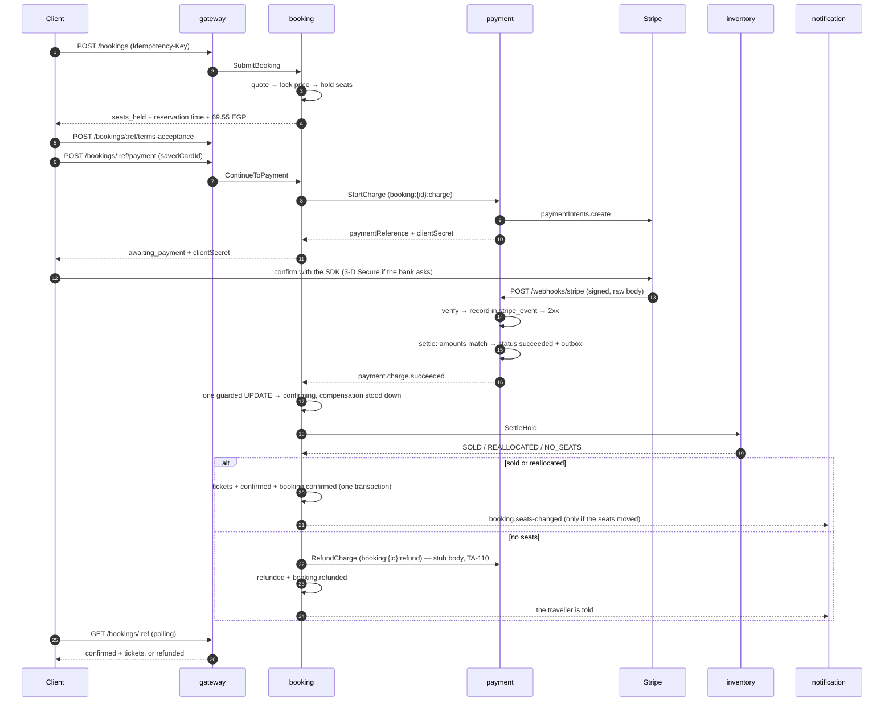

# TA-107 — Confirmation: the saga completes, or puts everything back

**Branch:** `feat/TA-107-confirmation-saga`
**Base:** `fix/integration-tests-order-independent-and-archeticture-test-violations` at `9eef37b`
**Jira:** [TA-107](https://muhanaddata4.atlassian.net/browse/TA-107) · 5 points · Sprint 4 · Epic [TA-104](https://muhanaddata4.atlassian.net/browse/TA-104)

This document is for whoever reviews the branch. It answers three questions:
how the acceptance criteria are satisfied, what changed against the base
branch and why, and what a traveller actually walks through in this code.

---

## 1. What the story is about

A traveller has been charged. From that instant there are exactly two
acceptable endings: they hold tickets for real seats, or they have all their
money back. The story's weight is in the second case — BR-36, the late payment,
where the hold expired while the bank was thinking. The saga must then try the
same seats, then different seats in the same class at the same locked fare, and
only then refund everything including the booking fee.

Two rules shape every decision below:

- **The client's word proves nothing.** Stripe's SDK telling the browser "it
  worked" is a hint to start polling, never a confirmation (BR-33). Only a
  signature-verified webhook moves the saga.
- **The guarantee lives in the database.** One ticket per passenger per leg is a
  unique index. A seat sold once is an exclusion constraint. Not an `if`.

---

## 2. Verifying it yourself

```bash
docker compose up -d          # postgres, rabbitmq, redis
npm run lint                  # clean
npm run test                  # 2695 passed, 1 skipped
npm run test:int              # 204 passed, 6 skipped
npm run test:holds            # 180 passed  ← the saga's real tier
```

`test:holds` is the tier that matters here: it runs against the compose stack
with real Postgres and real RabbitMQ, and it kills and restarts a real booking
process rather than simulating a crash. The 6 skips in `test:int` are
`stations-cache`'s `skipIf`, unrelated to this story.

---

## 3. How each acceptance criterion is satisfied

Eleven of the fourteen are proven by a test that matches the criterion
directly. Three are proven in two halves — see the note after the table.

| # | Criterion | Proven by |
| --- | --- | --- |
| 1 | Live hold + verified payment → held seats on held segments sold, one ticket per passenger per leg, read returns `confirmed` with tickets | [booking-confirmation.int-spec.ts:235](../test/integration/booking-confirmation.int-spec.ts#L235) · [hold-settlement.int-spec.ts:336](../test/integration/hold-settlement.int-spec.ts#L336) (segment identity) · [booking-flow.response.spec.ts](../apps/booking/src/modules/flow/booking-flow.response.spec.ts) (the read) |
| 2 | The client's word alone never confirms | [booking-confirmation.int-spec.ts:251](../test/integration/booking-confirmation.int-spec.ts#L251) |
| 3 | Event delivered twice → one ticket set, sold once, published once | [booking-confirmation.int-spec.ts:257](../test/integration/booking-confirmation.int-spec.ts#L257) |
| 4 | Booking killed between selling and issuing → tickets issued exactly once | [booking-confirmation-recovery.int-spec.ts:377](../test/integration/booking-confirmation-recovery.int-spec.ts#L377) — a real abrupt process kill |
| 5 | Booking stopped when the payment succeeds → confirmed once it starts | [booking-confirmation.int-spec.ts:284](../test/integration/booking-confirmation.int-spec.ts#L284) · [recovery:453](../test/integration/booking-confirmation-recovery.int-spec.ts#L453) |
| 6 | Hold expired, same seats free → confirmed with the same seats | [hold-settlement.int-spec.ts:356](../test/integration/hold-settlement.int-spec.ts#L356) + the shared confirm path |
| 7 | Seats taken → new seats in the same class, fare unchanged, traveller told | [hold-settlement:365](../test/integration/hold-settlement.int-spec.ts#L365)/[378](../test/integration/hold-settlement.int-spec.ts#L378) · [recovery:238](../test/integration/booking-confirmation-recovery.int-spec.ts#L238) · [confirmation-service:233](../test/integration/booking-confirmation-service.int-spec.ts#L233) (still 6955) · [seats-changed.consumer.spec.ts](../apps/notification/src/modules/booking-outcomes/consumers/seats-changed.consumer.spec.ts) |
| 8 | No seat left → the whole 6955 refunded, fee included, no ticket | [booking-confirmation:295](../test/integration/booking-confirmation.int-spec.ts#L295) · [recovery:469](../test/integration/booking-confirmation-recovery.int-spec.ts#L469) · [booking-refunded.consumer.spec.ts](../apps/notification/src/modules/booking-outcomes/consumers/booking-refunded.consumer.spec.ts) — **but read §6 first: the refund body is a stub owned by TA-110, so no money leaves Stripe yet.** What is proven here is that the saga decides to refund, calls `RefundCharge` over the real gRPC transport with the right amount and key, retries until it succeeds, and reaches `refunded`. |
| 9 | Round trip, return leg sold out → whole booking refunded, no outbound ticket | [hold-settlement:687](../test/integration/hold-settlement.int-spec.ts#L687) + AC 8's refund path |
| 10 | Hold expires before success → the Stripe payment is cancelled so it cannot succeed later | `cancel` → `intents.cancelFor` → `paymentIntents.cancel` with `booking:{id}:cancel`, in [payment-intent.service.ts](../apps/payment/src/modules/charges/services/payment-intent.service.ts) |
| 11 | Expiry and success at the same instant → exactly one outcome | [booking-confirmation:313](../test/integration/booking-confirmation.int-spec.ts#L313) · [hold-settlement:551](../test/integration/hold-settlement.int-spec.ts#L551)/[565](../test/integration/hold-settlement.int-spec.ts#L565)/[582](../test/integration/hold-settlement.int-spec.ts#L582) |
| 12 | Trip cancelled while paying → refunded in full, no ticket | [hold-settlement:671](../test/integration/hold-settlement.int-spec.ts#L671) + AC 8's refund path |
| 13 | "Who was charged without a ticket?" has an answer | [service-info.controller.spec.ts](../apps/booking/src/service-info.controller.spec.ts) (gauge) · [booking-flow.worker.spec.ts:48](../apps/booking/src/modules/flow/booking-flow.worker.spec.ts#L48) (the ALERT log) · [charged-without-a-ticket.md](charged-without-a-ticket.md) (the query) |
| 14 | Notification down → the booking is still confirmed (BR-54) | [booking-confirmation:330](../test/integration/booking-confirmation.int-spec.ts#L330) |

**On 6, 9 and 12.** The behaviour is implemented and each half is genuinely
proven — inventory's decision in `hold-settlement`, booking's reaction in
`booking-confirmation` — but no single test walks the criterion end to end. A
reviewer reading the ACs literally will notice. Each is about fifteen lines on
top of the existing `newBooking` / `expireTheHold` / `sellEverySeatInClass`
helpers, and they are the first follow-up worth doing.

---

## 4. What changed against the base branch

108 files, +7372/−633 across 18 commits. The base branch already had the
checkout flow up to `awaiting_payment`, the resume and compensation workers with
leases and dead-lettering, the hold lifecycle, and the outbox and inbox
libraries. This branch adds everything after the money moves.

### Payment — the charge path TA-106 had not built

The base had saved-card selection on `StartCharge` and a
signature-verified webhook for setup intents, but **no charge was ever created
at Stripe** — `PaymentDoubleService` flipped a row's status from an env-var
list. Because TA-106 is upstream of this story, that gap was built for real
rather than faked.

| Change | Why |
| --- | --- |
| `outbox_event` + `OutboxModule` ([migration](../apps/payment/src/database/migrations/1797000000001-create-payment-outbox-and-stripe-event.ts)) | Payment could not publish a durable event at all. Nothing downstream could exist without this. |
| `stripe_event` inbox, unique on `(object_id, type)` | Stripe resends events, and sends two ids for the same object and type. Recording is what earns the 2xx. |
| [payment-intent.service.ts](../apps/payment/src/modules/charges/services/payment-intent.service.ts) | One PaymentIntent per booking, idempotency key `booking:{id}:charge` — derived, never random, no personal data. A retry after a decline reuses the same intent (BR-35). |
| [charge-webhook.service.ts](../apps/payment/src/modules/charges/services/charge-webhook.service.ts) | Records, then settles: amount **and** `amount_received` must equal the locked total or it is an alarm, not a confirmation. Status moves forward only, so a late failure never overwrites a success. |
| [payment-recovery.worker.ts](../apps/payment/src/modules/charges/payment-recovery.worker.ts) | Drains the inbox after a crash, so an event recorded before a kill still gets published. |
| `RefundCharge` in [payment.proto](../libs/contracts/src/proto/payment.proto) | Contract real, body dummied — see §6. |
| [pii-redactor.ts](../libs/common/src/logging/pii-redactor.ts) | `pi_..._secret_...` joins the redaction list now that a client secret is on the wire; `record()` also strips `client_secret` before storing a payload. |

### Inventory — selling a hold, and BR-36's branch

`SettleHold` is one RPC keyed by the booking that returns `SOLD`,
`REALLOCATED` or `NO_SEATS`. The whole decision happens in **one transaction**
holding the sorted trip locks, because two acceptance criteria are unreachable
otherwise: the concurrent expiry-versus-payment race, and the round trip that
must settle as a single decision or not at all.

- [hold-settlement.service.ts](../apps/inventory/src/modules/seat-hold/services/hold-settlement.service.ts) — sell the live hold; else re-acquire exactly the stored seats; else the BR-25 allocator across every leg; else change nothing.
- `HoldState` gains `SOLD`; `seat_hold_group` gains `settlement_outcome`, with a check constraint making `state = 'sold'` legal **only** alongside a `SOLD`/`REALLOCATED` outcome — so a half-written sale cannot exist.
- Re-acquiring reads the passenger tokens from inventory's own assignment rows, which survive the hold's expiry, so BR-27 still holds even when identity is down.
- Selling and reallocating append `inventory.seat.availability-changed` in the same transaction, so search follows events only (SEAT-4).

### Booking — the saga

- Four new flow states: `confirming` → `confirmed`, `refunding` → `refunded`.
- [payment-succeeded.consumer.ts](../apps/booking/src/modules/flow/payment-succeeded.consumer.ts) performs **one guarded `UPDATE`** that starts the saga and, in the same statement, stands the compensation down (`compensation_status = 'none'`). Without that second half, the compensation worker would release the hold while the saga was settling it.
- That single statement is also how the race is won: Postgres serialises the expiry sweep and the payment event, so exactly one wins and neither "sold and refunded" nor "neither" is reachable.
- [booking-confirmation.service.ts](../apps/booking/src/modules/flow/services/booking-confirmation.service.ts) walks one step per call so the worker's lease bounds the work: settle → record → confirm or refund. Tickets, the state change and the outbox entry commit in **one** transaction.
- [ticket.entity.ts](../apps/booking/src/modules/flow/entities/ticket.entity.ts) — `UNIQUE (booking_reference, passenger_ref, trip_id)` is the AC, not an `if`.

### Notification, gateway, docs

`booking.seats-changed` and `booking.refunded` get consumers; `booking.confirmed`
is published and deliberately left for TA-108's email. `BookingResponse` gains
`tickets` and `seatsChanged`, passed through the gateway unchanged — no new
route, because `GET /bookings/:ref` is the poll.

### Test infrastructure

The kill-and-restart criteria say the test must kill the service, not simulate
it, so the harness boots a real booking process in a subprocess
([booking-confirmation-subprocess.ts](../test/integration/support/booking-confirmation-subprocess.ts)) and each run gets an
ephemeral RabbitMQ vhost ([rabbit-vhost.ts](../test/integration/support/rabbit-vhost.ts)) so queue bindings cannot leak
between specs.

---

## 5. The traveller's journey through this code



Step by step, in the code:

1. **`POST /bookings`** → `SubmitBooking`. [booking-flow.service.ts](../apps/booking/src/modules/flow/services/booking-flow.service.ts) walks quote → price lock (BR-30) → hold. The traveller sees their seats, the reservation clock and the locked total.
2. **`POST /bookings/:ref/terms-acceptance`** records the acceptance once, with its time. `ContinueToPayment` refuses without it.
3. **`POST /bookings/:ref/payment`** with the chosen saved card. Booking checks the hold is live and theirs, then asks payment to start the booking's one charge. Payment creates the PaymentIntent and returns the client secret; the booking moves to `awaiting_payment`.
4. **The client confirms with Stripe's SDK.** If the bank asks for 3-D Secure, that runs between the client, Stripe and the bank — never through this system. The SDK saying "it worked" only tells the client to start polling.
5. **Stripe calls `POST /webhooks/stripe`.** The signature is verified over the raw body; a body changed by one byte is a 400. The event is recorded in `stripe_event` and acknowledged immediately — business processing happens afterwards.
6. **Settling the event** checks Stripe's amount and currency against the locked total, moves the charge forward only, and appends `payment.charge.succeeded` in the same transaction.
7. **Booking consumes it** on `booking.payment.succeeded`, deduplicated by event id, and makes the one guarded transition into `confirming`.
8. **`SettleHold`** turns the hold into sold seats — or, if the hold expired while the bank was thinking, re-acquires the same seats, allocates new ones in the same class, or refuses.
9. **Confirming** issues one ticket per passenger per leg, marks the booking confirmed, and writes `booking.confirmed` — all in one transaction, so there is no state where a ticket exists without the event or vice versa.
10. **Or refunding** asks payment for the whole locked total, booking fee included, and tells the traveller why. **Today that call marks the charge refunded in payment's own database and returns a synthetic reference — it does not call Stripe.** The real `refunds.create` is TA-110's (§6), and nothing on this branch changes when it lands.
11. **`GET /bookings/:ref`** is what the client polls. It answers `confirming` while the saga runs — never `confirmed` early — then `confirmed` with the tickets, or `refunded`.

---

## 6. Seams: what is real, and what is deliberately not

The rule on this branch is directional. Work this saga needs from a story
**before** it was built for real; work owned by a story **after** it is dummied
behind a contract that is real, so the owner replaces a body and not a shape.

| Seam | Owner | State here |
| --- | --- | --- |
| PaymentIntent, charge webhook, `payment.charge.succeeded`, payment's outbox | TA-106, mohanad | **Built for real.** Upstream, and this saga's only trigger. |
| 3-D Secure's single hold extension, decline codes, the minimum-charge refusal, retry after a decline | TA-106, mohanad | Not built — the charge pieces this saga does not need. |
| Ticket QR, rendering, the confirmation email | TA-108, Mohamed Elsayed | Not built and not faked. This story issues the ticket row; `booking.confirmed` is published for him. |
| The refund's Stripe call and lifecycle | TA-110, Youssef Mostafa | **Contract real, body dummied**, marked `TODO(TA-110, Youssef Mostafa)` in [payment-double.service.ts](../apps/payment/src/modules/charges/services/payment-double.service.ts). |
| Cancellation tiers and the refund preview | TA-109, Hajar Elewa | Not built. |
| Full Stripe-versus-bookings reconciliation | PLAT-4, Sprint 5 | Not built; §13's query, log and gauge are what it will read. |

> **Note for mohanad:** this branch implements the PaymentIntent and the charge
> webhook that TA-106 still has assigned. Coordinate before writing them again
> — the collision points are `payment.proto` and `PaymentDoubleService`.

---

## 7. Known follow-ups

1. **No money actually returns to a card yet.** `RefundCharge`'s body is a stub
   owned by TA-110 (§6). Every refund decision, amount, retry and state
   transition on this branch is real and tested; the `stripe.refunds.create`
   call is not written. Anyone demonstrating the BR-36 refund path should say
   so out loud.
2. The three end-to-end tests for ACs 6, 9 and 12 described in §3.
3. `1797000000001`'s `down()` drops both tables but leaves `payment_charge.stripe_payment_intent_id`, so revert-then-reapply fails on the duplicate column.
4. `booking.confirmed` has no consumer until TA-108 adds the email. It is published and durably queued, which is what AC 14 asserts.

---

## 8. Design and plan

The reasoning behind these decisions, including the approaches that were
rejected, is in the design document and the task-by-task plan. Both are kept
locally and untracked, under `.superpowers/specs/` and `.superpowers/plans/`,
dated 2026-11-21.
